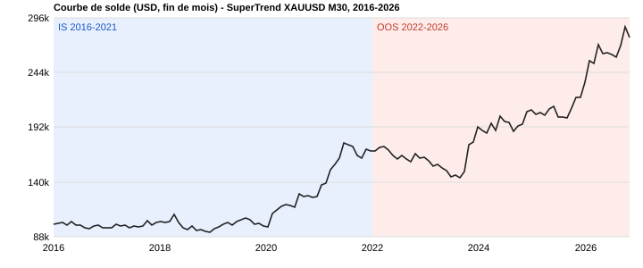

# Donchian TrendFollow — XAUUSD M30

Stratégie de suivi de tendance par cassure de canal Donchian (inspirée des Turtles), codée en MQL5.

> **EN summary** — Donchian-channel breakout trend follower on XAUUSD M30, tested 2016-2026 (3,844 trades). Profit factor 1.19, Sharpe 0.92, max drawdown 22-24%. IS (2018-2023) and OOS (2023-2026) profit factors are nearly identical (1.16 vs 1.15). **Key limitation: net profit is concentrated in ~10 trades (typical fat-tail trend-following profile), and swap costs total -56k USD.**

## Idée

Les marchés tendanciels produisent quelques mouvements très larges. La stratégie accepte de nombreuses petites pertes (~40 % de trades gagnants) pour capturer ces mouvements : gain moyen 781 $ contre perte moyenne 439 $.

## Logique (version testée)

- **Entrée** : clôture hors du canal Donchian de 10 barres (entrée rapide).
- **Sortie** : clôture hors du canal de 110 barres (sortie lente), plus SL ATR(14) × 1,0 comme filet.
- **Filtre actif** : compression du canal (largeur du canal de 20 barres sous le 50e percentile de ses 200 dernières valeurs).
- **Sizing** : risque fixe de 500 $ par trade (0,5 % du capital initial), modulé par un vol-target (facteur borné entre 0,4 et 1,25).
- **Gestion** : sortie partielle de 50 % à 1R, time stop (40 barres, fermeture si progression < 0,5R), règles de ré-entrée après perte, limites de risque journalières.
- **Options disponibles mais désactivées** : ensemble de 3 canaux, t-stat de pente, Efficiency Ratio, régime de volatilité, session, spread, news, EMA HTF, breakeven, trailing.

Inputs exacts : [`Donchian_TF_M30_tested.set`](Donchian_TF_M30_tested.set). Code : [`Donchian_TrendFollow_EA.mq5`](Donchian_TrendFollow_EA.mq5).

> Note : la valeur par défaut du timeframe dans le code est M15 ; le test a été fait en **M30** (voir le `.set`).

## Protocole de test

- Optimisation en **IS 2018-2023**, validation en **OOS 2023 - fin sept. 2026**, puis test sur **2016 - oct. 2026**.
- Données : IC Markets (EU) Demo, XAUUSD, qualité d'historique 87 %, 13,5 M de ticks. Dépôt initial 100 000 USD, levier 1:100.

## Résultats (2016-01-19 → 2026-10-23)

| Métrique | Valeur |
|---|---|
| Trades | 3 844 (longs 2 008, shorts 1 836) |
| Profit net | +196 646 $ |
| Profit factor | 1,19 |
| Sharpe | 0,92 |
| Espérance par trade | +51,16 $ |
| Trades gagnants | 40,17 % |
| Gain moyen / perte moyenne | 781 $ / −439 $ |
| Drawdown max (solde) | 56 464 $ (22,43 %) |
| Drawdown max (equity) | 61 997 $ (24,10 %) |
| Facteur de récupération | 3,17 |
| Pertes consécutives max | 12 (−6 175 $) |
| Durée moyenne de position | 18 h 08 |

### IS / OOS

Découpage par date de clôture des trades.

| Période | Trades | Profit net | Profit factor |
|---|---|---|---|
| 2016-2017 (hors optimisation) | 386 | +51 724 $ | 1,54 |
| IS 2018-2022 | 1 997 | +87 233 $ | 1,16 |
| OOS 2023 - sept. 2026 | 1 432 | +57 148 $ | 1,15 |

### Par année

## Coûts

- **Swap : −56 476 $** sur la période, soit environ 22 % du profit avant swap (253 122 $).
- **Commission : 0 $** dans ce test (type de compte sans commission). Un compte à commission réduirait le résultat ; à tester.
- Spread : celui du broker dans le testeur MT5.

## Limites (à lire avant toute conclusion)

1. **Concentration des gains.** Les 10 plus gros trades représentent 98,7 % du profit net. Sans eux : +2 574 $. Sans les 20 plus gros : −108 585 $. Le plus gros trade seul pèse 16 % du total (janv. 2020). C'est le profil attendu d'un trend following à queues épaisses, mais l'edge repose sur la fréquence de ces événements.
2. **Année 2023 : −33 342 $**, première année de la période OOS.
3. **Dépendance à l'or.** 2025 et 2026 (+42 966 $ et +38 786 $) coïncident avec une forte tendance haussière ; un régime sans tendance dégraderait les résultats.
4. **Un seul actif, un seul backtest.** Pas encore de test sur d'autres instruments ni de walk-forward complet.
5. **Optimisation sur les paramètres** : la proximité IS/OOS est encourageante, mais ne remplace pas une étude de sensibilité.
6. **Swap significatif** : la rentabilité dépend des conditions de financement du broker.

## Prochaines étapes

- Test « sans les N meilleurs trades » et bootstrap de la séquence de trades.
- Heatmap de sensibilité des paramètres clés (périodes d'entrée/sortie).
- Walk-forward glissant.
- Test avec commissions réalistes.
- Application à d'autres instruments.
