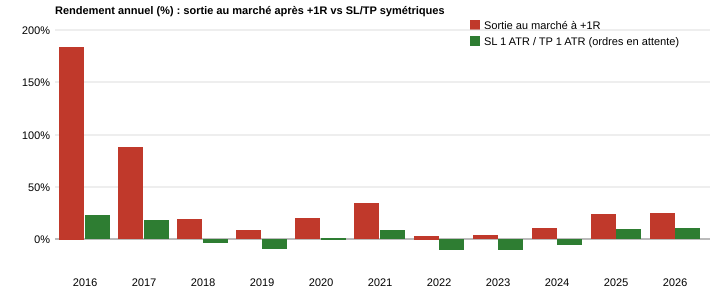

# AMRM : post-mortem d'un faux avantage

> **EN summary** — An XAUUSD H1 trend-pullback EA looked profitable in backtest (PF 1.15, +1.95M USD from 100k). Auditing it showed the edge came from three things: management bugs, then an **asymmetric exit** (winners closed at market after the +1R level was crossed, losers closed by a resting stop). Winners exited at +1.19R on average while losers exited at exactly -1.00R. Replacing both exits with resting SL = TP = 1 ATR orders collapsed the result to **PF 1.016, +27.5k USD, 39% drawdown** (expectancy +0.011R per trade, below realistic spread and commission). Lesson: the backtest engine can manufacture an edge that live trading will not deliver.

## Contexte

EA MQL5 sur XAUUSD, signaux sur H1 : filtre de tendance (ADX, croisement de moyennes mobiles), pullback vers la moyenne de Bollinger, stop à 1 ATR. Période de test : 2016-2026, dépôt de 100 000 USD, IC Markets (EU) Demo, risque 0,5 % du solde par trade.

Le premier backtest donnait des résultats irréalistes (de l'ordre du milliard à partir de 100 000 USD). Voici comment le diagnostic s'est déroulé.

## Étape 1 : bugs de gestion de position (version V1.3)

La relecture du code a révélé cinq problèmes :

1. La sortie partielle à +1R se répétait à chaque tick : la position était quasi soldée à +1R, ce qui revenait à un SL de -1R et un TP de +1R.
2. Le risque (1R) était recalculé depuis le stop courant : après le premier trailing, la gestion du trade s'arrêtait.
3. La ré-entrée se faisait en cours de barre, juste après une sortie.
4. La gestion des positions était coupée hors session ou quand une limite de risque était atteinte.
5. La taille de position n'était pas plafonnée, avec une capitalisation sur 10 ans.

Ces points sont corrigés dans [`AMRM_Quant_Manhattan_V2_1.mq5`](AMRM_Quant_Manhattan_V2_1.mq5).

## Étape 2 : l'avantage « corrigé »

| Réglage | Profit net | Profit factor | Drawdown (solde) |
|---|---|---|---|
| A. Partiel à 1R, reste fermé à 1,5R (via `Trail_ATR_Mult=0`) | +1 112 090 USD | 1,15 | 11,5 % |
| B. Partiel à 1R, reste fermé aussi à 1R (`Target2R=1`) | +1 950 255 USD | 1,15 | 12,6 % |
| C. SL = TP = 1 ATR, ordres en attente, sans partiel | +27 544 USD | 1,016 | 39,0 % |

Resserrer l'objectif (A vers B) augmentait le profit et réduisait le drawdown, ce qui aurait dû alerter.

## Étape 3 : le diagnostic

Dans le test B, chaque position est exprimée en multiples de R (le risque initial) :

- Pertes : sorties à **-1,002R** en moyenne (médiane -1,000R). Le stop est un ordre en attente, exécuté à son niveau.
- Gains : sorties à **+1,19R** en moyenne (médiane +1,08R, 90e centile +1,48R). L'EA ferme au marché au premier tick au-delà de +1R. Dans les rapports, toutes les exécutions tombent aux secondes 0, 20, 40 et 59 : les ticks sont synthétiques, générés depuis des barres M1, et le prix « saute » le niveau.
- Espérance : **+0,111R** par position. Avec les gains plafonnés à +1,0R, elle tombe à **+0,011R**.

## Étape 4 : le test symétrique (réglage C)

SL et TP sont posés comme ordres en attente, tous les deux à 1 ATR, sans partiel. Les deux côtés s'exécutent donc à leur niveau exact.

- Gains moyens : +0,993R, médiane +1,000R. Pertes moyennes : -1,002R.
- Espérance mesurée : **+0,0112R**, soit exactement la valeur prédite par le plafonnement (+0,0111R).
- Taux de gagnants : 50,8 %. Gain moyen 615 USD, perte moyenne -625 USD.
- PF 1,016, Sharpe 0,39, drawdown 39,0 %.

| Année | Sortie au marché (B) | Ordres symétriques (C) |
|---|---|---|
| 2016 | +184,2 % | +22,8 % |
| 2017 | +88,2 % | +18,6 % |
| 2018 | +18,9 % | -4,1 % |
| 2019 | +8,4 % | -9,7 % |
| 2020 | +20,3 % | +1,5 % |
| 2021 | +34,2 % | +9,0 % |
| 2022 | +3,4 % | -10,5 % |
| 2023 | +3,9 % | -10,8 % |
| 2024 | +10,8 % | -5,4 % |
| 2025 | +24,1 % | +9,7 % |
| 2026 | +24,7 % | +10,4 % |

## Coûts : ce qui manque encore

Dans le test C, avant swap : +45 809 USD. Après le swap (-18 265 USD) : +27 544 USD. Il reste à retirer, sur 9 803 lots d'entrée :

- Commission (3,5 USD par lot et par côté) : environ 68 600 USD.
- Spread : environ 98 000 USD à 0,10 USD, 196 000 USD à 0,20 USD.

L'espérance positive est donc plus petite que les coûts d'exécution : après coûts, la stratégie perd de l'argent.

## Conclusion

- **Aucun avantage démontré** pour cette stratégie sur XAUUSD H1 avec ces règles.
- Un backtest peut fabriquer un avantage quand les entrées et les sorties ne s'exécutent pas de façon symétrique. Un contrôle simple : comparer la distribution des gains et des pertes en multiples de R.
- Les ticks synthétiques accentuent cet effet pour les sorties surveillées tick par tick.
- Test de robustesse à refaire avant de croire un résultat : ticks réels, coûts complets, sorties symétriques.

## Fichiers

- [`AMRM_Quant_Manhattan_V2_1.mq5`](AMRM_Quant_Manhattan_V2_1.mq5) : code corrigé.
- [`set_B_partial_target1R.set`](set_B_partial_target1R.set) : réglage B ci-dessus (partiel + objectif à 1R).
- [`set_C_symmetric_SL1_TP1.set`](set_C_symmetric_SL1_TP1.set) : réglage C ci-dessus (SL = TP = 1 ATR).

Le réglage A a été testé avec la version V2 du code (`Trail_ATR_Mult=0`), antérieure à la V2.1 publiée ici.
