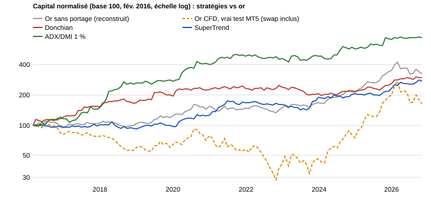

# Comparaison avec l'achat-conservation de l'or

> **EN summary** — Benchmark of the published strategies (Donchian, SuperTrend, ADX/DMI) against two buy-and-hold gold references over Feb 2016 – Oct 2026. (1) Gold without carry (unlevered, rebuilt from backtest prices): 11.7%/yr, Sharpe 0.78. (2) **A real MT5 buy-and-hold test on the same IC Markets CFD**: 0.91 lot bought in Jan 2016 and held to Oct 2026 made +79.5% (5.6%/yr, 4.7%/yr on the common window) because **swap cost 187k USD, 70% of the 267k gross gain**, with a 47.7% max equity drawdown (74.6% relative). Against the real CFD benchmark, Donchian, SuperTrend and ADX/DMI all do better; against gold without carry they do not, except ADX/DMI on Sharpe over the full period (not out-of-sample). Their main value is diversification (correlation with gold between -0.1 and 0.3): a 50/50 mix of gold and SuperTrend keeps the return (11.3% vs 11.7%) at half the drawdown.

## En bref

- **Référence principale : le vrai buy and hold du CFD XAUUSD, testé dans MT5** (0,91 lot acheté le 18 janv. 2016 et gardé jusqu'au 29 oct. 2026, même broker et mêmes coûts que les stratégies) : **+79,5 % en 10,8 ans, soit 5,6 %/an**, avec **187 176 USD de swap (70 % du gain brut)** et un drawdown de l'equity de **47,7 %** (74,6 % en relatif).
- **Les trois stratégies publiées font mieux que ce buy and hold** : 9,9 % à 20,8 %/an et 17 à 21 % de drawdown, pour 4,7 %/an et 72,5 % de drawdown (fenêtre fév. 2016 - oct. 2026).
- **Référence secondaire : l'or en prix seul** (sans coût de portage, comme un ETF), à 11,7 %/an. Le Donchian et le SuperTrend ne le battent pas ; l'ADX/DMI le bat en Sharpe sur la période complète, mais pas en OOS (2023-2026).
- Leur principal intérêt : la **diversification** (corrélation avec l'or de −0,1 à 0,3).

## Pourquoi cette comparaison

Une stratégie sur l'or doit être jugée contre la solution la plus simple : acheter l'or et ne rien faire. Sur la période, l'or est passé d'environ 1 090 à 4 000 USD (×3,7). Une stratégie qui rapporte moins avec plus de travail n'apporte rien si elle ne réduit pas le risque ou ne diversifie pas.

Il y a deux façons de « détenir l'or » : sans coût de portage (ETF ou métal physique, frais négligeables), ou via le **CFD** du broker, sur lequel on paie un swap chaque nuit. Les stratégies publiées tradent ce CFD et paient donc ce swap : leur référence équitable est le buy and hold du **même CFD**, que j'ai testé réellement.

## Méthode

- Période commune : **février 2016 - octobre 2026**, rendements **mensuels** (128 mois).
- **Or sans portage** : une position longue sans levier, reconstruite à partir des prix des transactions des backtests (environ 23 000 points, au moins 20 par mois).
- **Or CFD (vrai test MT5)** : un EA qui achète 0,91 lot de XAUUSD le 18 janvier 2016 à 1 090,43 (environ 1× le capital de 100 000 USD) et le garde jusqu'au 29 octobre 2026 (clôture à 4 021,19), sur le même broker, la même qualité de données et le même swap que les stratégies. Le rapport ne contient que l'ouverture et la clôture : la courbe mensuelle est reconstruite avec les prix des backtests et un swap qui s'accumule linéairement dans le temps. Contrôle : la reconstruction donne un drawdown relatif de 73,2 % contre 74,63 % dans le rapport, et un point bas de l'equity de 31 300 USD contre 29 900 USD.
- Stratégies : solde du compte en fin de mois (Donchian M30, SuperTrend M30 et ADX/DMI H1 publiés ; AMRM avec SL = TP, voir le [post-mortem](../amrm-postmortem/README.md)).
- Bêta et alpha : régression des rendements mensuels de chaque stratégie sur ceux de l'or.

## Résultats

### Le vrai buy and hold (CFD, test MT5)

| | Rapport MT5 |
|---|---|
| Période | 18 janv. 2016 → 29 oct. 2026 (10,8 ans) |
| Position | Achat de 0,91 lot XAUUSD à 1 090,43, clôture à 4 021,19 |
| Profit brut (mouvement du prix) | +266 699 USD |
| **Swap** | **−187 176 USD (70 % du profit brut)** |
| Profit net | +79 524 USD (+79,5 %, soit 5,6 %/an) |
| Drawdown max de l'equity | 160 360 USD (47,7 %) |
| Drawdown relatif max de l'equity | 74,6 % (87 937 USD) |
| Perte maximale depuis le dépôt initial | 70 102 USD (equity d'environ 29 900 USD) |

Le prix de l'or a été multiplié par 3,7, mais le portage (swap) absorbe 70 % du gain. L'equity passe sous la barre des 40 000 USD fin 2022 : avec un lot fixe, l'effet de levier réel grimpe quand le capital fond, d'où la volatilité très élevée (36,6 % par an).

| | Capital final (base 100, fév. 2016) | Rendement annualisé | Volatilité | Sharpe | Drawdown max (mensuel) | Corrélation avec l'or sans portage |
|---|---|---|---|---|---|---|
| Or sans portage | 324 | 11,7 % | 15,7 % | 0,78 | 24,1 % | 1,00 |
| **Or CFD (buy and hold réel)** | **162** | **4,7 %** | **36,6 %** | **0,30** | **72,5 %** | 0,92 |
| Donchian | 298 | 10,8 % | 13,7 % | 0,82 | 20,7 % | 0,31 |
| SuperTrend | 273 | 9,9 % | 13,1 % | 0,78 | 18,8 % | 0,06 |
| ADX/DMI, risque 1 % | 749 | 20,8 % | 18,2 % | 1,13 | 17,3 % | −0,07 |

(Sur la période du rapport, qui commence en janvier 2016, le buy and hold réel fait 5,6 %/an ; 4,7 % sur la fenêtre commune de février 2016.)

Part du swap dans le profit avant swap : **70 %** pour le buy and hold CFD, 22 % pour le Donchian (avec sortie partielle), 7 % pour le SuperTrend, 6 % pour l'ADX/DMI. Les stratégies sont en position une partie du temps seulement, donc elles paient bien moins de portage.

### Stratégies et or sans portage

| | Capital final (base 100) | Rendement annualisé | Volatilité | Sharpe | Drawdown max (mensuel) | Corrélation avec l'or |
|---|---|---|---|---|---|---|
| Or sans portage (prix seul) | 324 | 11,7 % | 15,7 % | 0,78 | 24,1 % | 1,00 |
| Donchian | 298 | 10,8 % | 13,7 % | 0,82 | 20,7 % | 0,31 |
| SuperTrend | 273 | 9,9 % | 13,1 % | 0,78 | 18,8 % | 0,06 |
| AMRM (SL = TP) | 124 | 2,1 % | 10,9 % | 0,24 | 37,8 % | 0,02 |

| | Bêta | Alpha annualisé | t-stat de l'alpha |
|---|---|---|---|
| Donchian | 0,27 | +7,9 % | 1,9 |
| SuperTrend | 0,05 | +9,7 % | 2,3 |

### Rendement annuel

| Année | Or sans portage | Or CFD (reconstruit) | Donchian | SuperTrend | AMRM (SL = TP) |
|---|---|---|---|---|---|
| 2016 | -6,2 % | −10,6 % | +19,4 % | -3,0 % | +22,8 % |
| 2017 | +12,8 % | −4,3 % | +27,0 % | +5,0 % | +18,6 % |
| 2018 | -1,8 % | −23,0 % | +9,6 % | -8,6 % | -4,1 % |
| 2019 | +18,8 % | +7,2 % | +15,8 % | +5,6 % | -9,7 % |
| 2020 | +24,6 % | +23,5 % | +16,4 % | +28,9 % | +1,5 % |
| 2021 | -3,5 % | −26,8 % | +3,9 % | +33,9 % | +9,0 % |
| 2022 | -0,7 % | −29,0 % | +2,6 % | -3,4 % | -10,5 % |
| 2023 | +13,4 % | +12,1 % | -14,0 % | +17,8 % | -10,8 % |
| 2024 | +26,5 % | +62,5 % | +4,5 % | +8,4 % | -5,4 % |
| 2025 | +65,5 % | +167,2 % | +20,0 % | +12,5 % | +9,7 % |
| 2026 (jusqu'en oct.) | -7,3 % | −18,5 % | +15,0 % | +17,9 % | +10,4 % |

### Mélanges avec l'or (prix seul)

| Portefeuille | Rendement annualisé | Sharpe | Drawdown max (mensuel) |
|---|---|---|---|
| 100 % or sans portage | 11,7 % | 0,78 | 24,1 % |
| 50 % or + 50 % Donchian | 11,6 % | 0,99 | 11,2 % |
| 50 % or + 50 % SuperTrend | 11,3 % | 1,07 | 11,6 % |
| Donchian + SuperTrend (50/50) | 10,7 % | 1,03 | 16,5 % |
| Un tiers chacun : or, Donchian, SuperTrend | 11,3 % | 1,16 | 10,3 % |

## Ajout : ADX/DMI (trois niveaux de risque)

Même méthode, même période (fév. 2016 - oct. 2026). Détail dans le [README de la stratégie](../../strategies/trend/adx-dmi/README.md).

| | Capital final (base 100) | Rendement annualisé | Volatilité | Sharpe | Drawdown max (mensuel) | Corrélation avec l'or | Bêta |
|---|---|---|---|---|---|---|---|
| Or sans portage (prix seul) | 324 | 11,7 % | 15,7 % | 0,78 | 24,1 % | 1,00 | 1,00 |
| ADX/DMI, risque 0,5 % | 283 | 10,2 % | 10,4 % | 0,99 | 10,3 % | −0,12 | −0,08 |
| ADX/DMI, risque 1 % | 749 | 20,8 % | 18,2 % | 1,13 | 17,3 % | −0,07 | −0,08 |
| ADX/DMI, risque 1,5 % | 1 166 | 25,9 % | 24,1 % | 1,08 | 25,9 % | −0,05 | −0,08 |

Corrélation de l'ADX/DMI (1 %) avec le Donchian : 0,23 ; avec le SuperTrend : 0,31. Mélange moitié or, moitié ADX/DMI à 1 % : 17,0 %/an, Sharpe 1,42, drawdown 11,8 %.

| ADX/DMI | Période | Sharpe | Alpha annualisé (t-stat) |
|---|---|---|---|
| 0,5 % | IS 2016-2022 / OOS 2023-2026 | 1,15 / 0,66 | +14,1 % (3,5) / +4,8 % (0,9) |
| 1 % | IS 2016-2022 / OOS 2023-2026 | 1,31 / 0,80 | +26,2 % (3,8) / +10,7 % (1,1) |
| 1,5 % | IS 2016-2022 / OOS 2023-2026 | 1,19 / 0,88 | +30,8 % (3,4) / +16,9 % (1,3) |

Sur 2023-2026, l'or fait +22,9 %/an avec un Sharpe de 1,18 : l'ADX/DMI fait moins bien en rendement et en Sharpe, et son alpha n'y est plus statistiquement significatif.

## Lecture

- **Contre le vrai buy and hold du CFD, toutes les stratégies publiées font mieux** : 4,7 %/an et un drawdown de 72,5 % pour le buy and hold réel, contre 9,9 % à 20,8 %/an et 17 à 21 % de drawdown. Une grande part de l'écart vient du swap qu'elles ne paient pas en tenant l'or en permanence.
- **Contre l'or sans portage, le Donchian et le SuperTrend ne battent pas l'or** : ni en rendement (10,8 % et 9,9 % contre 11,7 %), ni en Sharpe (0,82 et 0,78 contre 0,78). En 2025, année à +65,5 % pour l'or, elles font +20,0 % et +12,5 %.
- **Leur intérêt est la diversification** : corrélation de 0,31 et 0,06 avec l'or. Mélangées à parts égales avec l'or, elles gardent presque le même rendement avec environ la moitié du drawdown.
- **L'ADX/DMI est la seule à battre l'or en Sharpe sur la période complète** (0,99 à 1,13 contre 0,78), avec une corrélation légèrement négative. Cet avantage vient surtout de l'IS ; en OOS (2023-2026), elle est derrière l'or.
- **L'AMRM n'apporte rien** : rendement de 2,1 %, Sharpe de 0,24 et drawdown de 37,8 %, conforme au post-mortem.
- Corrélation entre le Donchian et le SuperTrend : 0,21.

## Limites

1. **Alpha fragile.** Les t-stats de 1,9 et 2,3 sont marginaux sur 128 mois, et les paramètres ont été optimisés sur la période : l'alpha réel est probablement plus faible.
2. **Données approximatives.** L'or est reconstruit à partir de prix de transactions et échantillonné au mois : son drawdown est sous-estimé. Pour les stratégies, le solde ne compte que les trades clôturés, sans les gains ou pertes latents.
3. **Coûts.** Les stratégies ne contiennent que le spread et le swap du testeur (commission à 0). L'or sans portage est supposé sans frais, ce qui l'avantage (un ETF coûte environ 0,4 % par an) ; l'or CFD inclut le swap.
4. **Taux de swap du testeur.** MetaTrader applique les taux de swap actuels du broker à tout l'historique, alors que les taux étaient bas jusqu'en 2021. Le buy and hold CFD est donc probablement plus pénalisé que dans la réalité sur les premières années ; les stratégies, qui paient moins de swap, le sont moins.
5. **Courbe du buy and hold CFD reconstruite.** Le rapport MT5 ne donne que l'ouverture et la clôture : la courbe et ses statistiques mensuelles sont approchées (écart de l'ordre de 2 points sur le drawdown relatif).
6. **Un seul actif, une seule période.** L'or a presque quadruplé sur la période, ce qui est favorable à l'achat-conservation.
7. Ticks synthétiques pour les backtests (voir les README des stratégies).

## Prochaines étapes

- Refaire la comparaison avec des taux de swap historiques, ou en ticks réels, et avec des données de prix journalières propres (drawdown de l'or réel).
- Tester le mélange avec des poids optimisés en walk-forward, pas en échantillon complet.
- Ajouter les coûts de commission aux stratégies.
