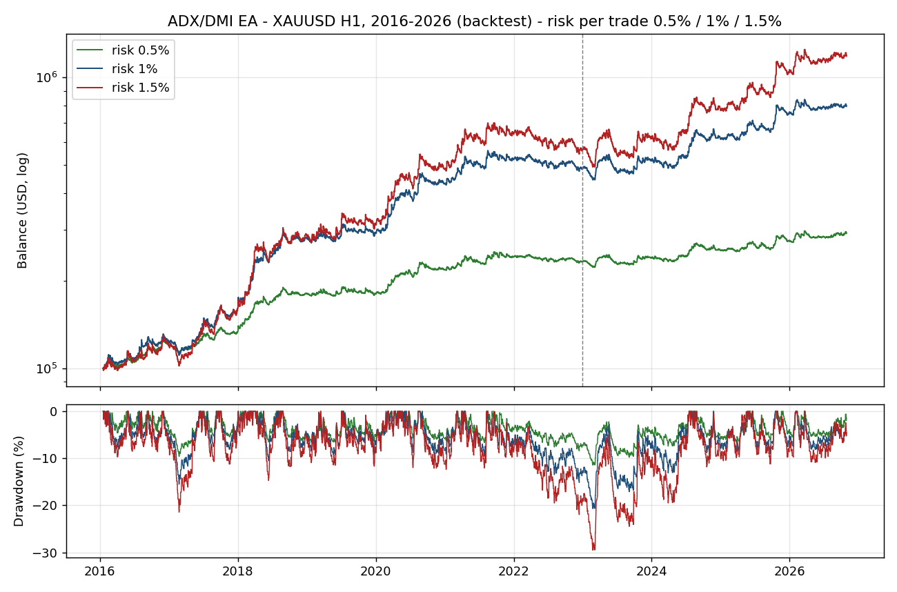
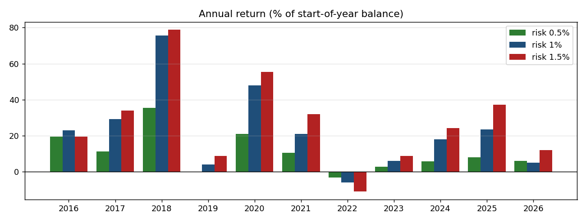

# ADX/DMI : suivi de tendance sur clôture, XAUUSD H1

EA MQL5 de suivi de tendance basé sur le système ADX/DMI. Tous les signaux sont calculés sur la dernière barre clôturée et exécutés à l'ouverture de la barre suivante. Le projet documente sa validation : optimisation IS, test OOS, ablation de chaque filtre de risque, et comparaison de trois niveaux de risque par trade.

> **EN summary** — Close-only ADX/DMI trend follower on XAUUSD H1, tested 2016-2026 (about 2,520 positions, 100k USD start, IC Markets demo, synthetic ticks). Profit factor 1.18-1.20 at 0.5% / 1% / 1.5% risk per trade, expectancy +0.14R per position, max balance drawdown 11% / 21% / 30%. Monthly Sharpe 0.99 / 1.13 / 1.08 vs 0.78 for buy-and-hold gold, correlation with gold about -0.1. **Out-of-sample (2023-2026) the return roughly halves, Sharpe falls to 0.66-0.88 and the alpha is not statistically significant (t about 1); in that window the strategy trails gold's rally (+22.9%/yr).** Ten positions make 45-59% of the profit. Backtest only, no live track record.

> Projet de recherche. Résultats de backtest uniquement, aucune performance réelle. Ceci n'est pas un conseil en investissement.



## Logique

| Bloc | Règle |
|---|---|
| Entrée longue | ADX > 20, ADX en hausse sur 2 clôtures consécutives, +DI > -DI + 5 |
| Entrée courte | Symétrique (-DI > +DI + 5) |
| Stop initial | 1,5 × ATR(14), pas de take profit fixe |
| Sortie 1 | ADX < 15 (tendance perdue) |
| Sortie 2 | Croisement des DI contre la position |
| Sortie 3 (épuisement) | Profit > 2,5 ATR et ADX en baisse sur 3 clôtures : fermeture de 30 %, le reste suit un Chandelier (plus haut des clôtures sur 10 barres - 2,5 ATR) |
| Break-even | Stop ramené à l'entrée (+10 points) quand le profit atteint 2R |
| Risque | 0,5 % / 1 % / 1,5 % de l'equity par trade ; taille calculée avec la valeur du tick (CFD et futures) |
| Filtres de risque | Risque ×0,5 quand l'equity est à plus de 5 % sous son sommet ; plus d'entrée après une perte de 2 % dans la journée |
| Session | Entrées entre 9h et 18h (heure serveur du broker) |

Une seule position à la fois. Le stop est un ordre en attente ; toutes les autres sorties sont décidées à la clôture d'une barre et exécutées à l'ouverture suivante.

Réglages exacts : [`ADX_DMI_XAUUSD_H1_risk0_5.set`](ADX_DMI_XAUUSD_H1_risk0_5.set), [`..._risk1.set`](ADX_DMI_XAUUSD_H1_risk1.set), [`..._risk1_5.set`](ADX_DMI_XAUUSD_H1_risk1_5.set) (seul le risque change). Code : [`src/ADX_DMI_EA.mq5`](src/ADX_DMI_EA.mq5).

> Les valeurs par défaut du code sont les points de départ de la recherche, pas les réglages finaux : utilise les fichiers `.set`.

## Protocole de test

- Optimisation en **IS 2016-2022**, test en **OOS 2023 - oct. 2026** avec les paramètres figés. L'OOS n'est pas totalement aveugle (voir les limites).
- Période complète : 2016-01-01 → 2026-10-29. IC Markets (EU) Demo, XAUUSD H1, dépôt 100 000 USD, levier 1:100, qualité d'historique 87 %.
- Les exécutions du rapport n'apparaissent qu'aux secondes 0, 20 et 40 : les **ticks sont synthétiques** (générés depuis des barres M1), pas des ticks réels.

## Résultats : période complète

Mêmes paramètres pour les trois runs, seul le risque par trade change. Les statistiques « par position » sont recalculées à partir des transactions des rapports (MetaTrader compte chaque sortie partielle comme une transaction).

| Métrique | Risque 0,5 % | Risque 1 % | Risque 1,5 % |
|---|---|---|---|
| Profit net | +190 803 USD | +695 368 USD | +1 083 470 USD |
| Rendement annualisé (composé) | 10,4 % | 21,1 % | 25,6 % |
| Profit factor | 1,18 | 1,20 | 1,18 |
| Facteur de récupération | 5,33 | 5,32 | 4,54 |
| Sharpe (MT5, par transaction) | 1,59 | 1,82 | 1,60 |
| Sharpe mensuel (or : 0,78) | 0,99 | 1,13 | 1,08 |
| Drawdown max (solde / equity) | 11,4 % / 13,9 % | 20,7 % / 22,8 % | 29,6 % / 32,8 % |
| Rendement annualisé / drawdown solde | 0,91 | 1,02 | 0,87 |
| Positions | 2 524 | 2 523 | 2 517 |
| Positions gagnantes | 33,7 % | 33,7 % | 33,7 % |
| Gain moyen / perte moyenne (par position) | 1 450 / −623 USD | 4 984 / −2 121 USD | 8 434 / −3 643 USD |
| Espérance par position | +75,6 USD | +275,6 USD | +430,5 USD |
| Espérance en R (risque initial) | +0,14R | +0,14R | +0,14R |
| Pertes consécutives max | 22 positions | 22 positions | 22 positions |
| Durée moyenne d'une position | 12 h 14 | 12 h 14 | 12 h 14 |
| Taille max d'une position | 5,6 lots | 17,0 lots | 31,8 lots |

**Lecture**
- Profit et drawdown augmentent avec le risque, mais pas de façon exactement proportionnelle (réduction du risque en drawdown, plafond journalier et arrondi des lots interagissent).
- **1 % donne le meilleur profil rendement/risque** sur ces données (Sharpe le plus élevé, meilleur rendement par point de drawdown). C'est une observation sur un backtest, pas une règle générale.
- Même à 0,5 %, le drawdown en equity (13,9 %) dépasse la limite de 10 % typique d'une propfirm : il faudrait environ 0,3 %.

### IS / OOS

Profit factor normalisé par le solde à l'entrée, et rendement annualisé calculé sur les rendements mensuels.

| | IS 2016-2022 : PF / rendement annualisé | OOS 2023-2026 : PF / rendement annualisé |
|---|---|---|
| Risque 0,5 % | 1,26 / 12,7 % | 1,15 / 5,9 % |
| Risque 1 % | 1,30 / 25,1 % | 1,19 / 13,5 % |
| Risque 1,5 % | 1,24 / 28,7 % | 1,21 / 21,0 % |

L'OOS se dégrade (le rendement annualisé est à peu près divisé par deux à 1 %) mais reste positif à tous les niveaux de risque.

### Rendement annuel (% du solde de début d'année)



| Année | 0,5 % | 1 % | 1,5 % |
|---|---|---|---|
| 2016 | +19,5 % | +23,1 % | +19,4 % |
| 2017 | +11,3 % | +29,3 % | +34,0 % |
| 2018 | +35,5 % | +75,6 % | +78,7 % |
| 2019 | −0,1 % | +4,0 % | +8,8 % |
| 2020 | +21,0 % | +48,0 % | +55,4 % |
| 2021 | +10,6 % | +21,1 % | +32,0 % |
| 2022 | −3,2 % | −6,0 % | −10,8 % |
| 2023 | +2,8 % | +6,0 % | +8,8 % |
| 2024 | +5,8 % | +18,1 % | +24,3 % |
| 2025 | +8,1 % | +23,6 % | +37,2 % |
| 2026 (jusqu'au 29 oct.) | +6,1 % | +5,0 % | +12,1 % |

## Comparaison avec l'achat-conservation de l'or

Rendements mensuels, février 2016 - octobre 2026 (voir le [dossier benchmark](../../../research/buy-and-hold-benchmark/README.md) pour la méthode).

| | Rendement/an | Volatilité | Sharpe | Drawdown max (mensuel) | Corrélation avec l'or | Bêta |
|---|---|---|---|---|---|---|
| Or, achat-conservation | 11,7 % | 15,7 % | 0,78 | 24,1 % | 1,00 | 1,00 |
| ADX/DMI 0,5 % | 10,2 % | 10,4 % | 0,99 | 10,3 % | −0,12 | −0,08 |
| ADX/DMI 1 % | 20,8 % | 18,2 % | 1,13 | 17,3 % | −0,07 | −0,08 |
| ADX/DMI 1,5 % | 25,9 % | 24,1 % | 1,08 | 25,9 % | −0,05 | −0,08 |

- Sur la période complète, la stratégie fait mieux que l'or en Sharpe, avec une corrélation proche de zéro. Un mélange moitié or, moitié ADX/DMI à 1 % donne 17,0 %/an, un Sharpe de 1,42 et un drawdown de 11,8 % (or seul : 11,7 %, 0,78 et 24,1 %).
- **Par période, le tableau est moins favorable :**

| | IS 2016-2022 : Sharpe / alpha (t-stat) | OOS 2023-2026 : Sharpe / alpha (t-stat) | Or en OOS |
|---|---|---|---|
| Risque 0,5 % | 1,15 / +14,1 %/an (3,5) | 0,66 / +4,8 %/an (0,9) | 22,9 %/an, Sharpe 1,18 |
| Risque 1 % | 1,31 / +26,2 %/an (3,8) | 0,80 / +10,7 %/an (1,1) | idem |
| Risque 1,5 % | 1,19 / +30,8 %/an (3,4) | 0,88 / +16,9 %/an (1,3) | idem |

L'alpha est significatif en IS (t-stat de 3,4 à 3,8) mais **pas en OOS** (t-stat d'environ 1) : la fenêtre OOS compte seulement 46 mois et l'or y a fortement monté (+22,9 %/an). Sur 2023-2026, la stratégie fait moins bien que l'or en rendement à tous les niveaux de risque.

## Contrôle de l'artefact de sortie

Sur une autre stratégie ([post-mortem AMRM](../../../research/amrm-postmortem/README.md)), un avantage venait de sorties asymétriques. Ici, le contrôle est propre : les pertes sortent à −1,00R pile (médiane, 10e et 50e centiles) car le stop est un ordre en attente, et les gains sont décidés à la clôture et exécutés à l'ouverture suivante (gain médian +1,78R). Il n'y a pas de sortie au marché déclenchée tick par tick.

## Coûts

- **Swap** : −14 088 / −46 477 / −70 540 USD, soit 6 à 7 % du profit avant swap.
- **Commission : 0 USD** dans le test. Avec 3,5 USD par lot et par côté (compte Raw), environ 25 400 / 77 400 / 125 300 USD sur 3 624 / 11 056 / 17 895 lots d'entrée, soit 11 à 13 % du profit net.
- Spread : celui du testeur (non mesuré séparément).

## Concentration des gains

| | Risque 0,5 % | Risque 1 % | Risque 1,5 % |
|---|---|---|---|
| 5 meilleures positions / profit net | 25 % | 28 % | 35 % |
| 10 meilleures positions / profit net | 45 % | 49 % | 59 % |
| Profit sans les 10 meilleures | +104 765 USD | +353 315 USD | +446 705 USD |
| Profit sans les 20 meilleures | +37 547 USD | +93 866 USD | +3 857 USD |

Moins extrême que sur le Donchian, mais à 1,5 % de risque le profit repose presque entièrement sur 20 positions.

## Ce que la validation a montré

- **Les filtres de risque n'ajoutent pas d'alpha.** Les désactiver double à peu près le profit et le drawdown : c'est équivalent à augmenter le risque par trade, pas une meilleure stratégie.
- **Le filtre de session compte le plus.** Sans lui, le profit factor et le Sharpe chutent nettement.
- **Le seuil d'entrée ADX n'est pas stable.** L'optimum IS (30) était un pic isolé qui n'a pas tenu en OOS ; un seuil bas (20) a été retenu pour le nombre de trades.
- **Les filtres par heure ont été rejetés** : les résultats changent de signe d'une heure à l'autre et d'une période à l'autre (bruit).

Détails dans [`docs/validation.md`](docs/validation.md).

## Limites

1. **Backtest uniquement**, sur ticks synthétiques ; commission à 0 ; swap significatif.
2. **OOS non aveugle** : la fenêtre 2023-2025 a été inspectée pendant l'exploration. Et en OOS, l'alpha contre l'or n'est pas statistiquement significatif (t-stat d'environ 1).
3. **Nombre de configurations testées non consigné** (grille d'optimisation, ablations, filtres horaires) : le risque de sur-ajustement est plus élevé que ce que les statistiques seules suggèrent.
4. **Longue phase plate** : le solde stagne de mi-2021 à fin 2023, avec le drawdown maximal atteint début 2023. Il faut s'attendre à des plateaux de plusieurs années.
5. Environ une position sur trois est gagnante ; les séries de pertes atteignent 22 positions.
6. Rendements concentrés sur certaines années (2018, 2020, 2025) ; 2022 est négative, 2019 et 2023 sont faibles.
7. **Tailles de position** : jusqu'à 31,8 lots à 1,5 % de risque (plus de 3 000 onces), sans plafond ni modèle d'impact de marché.
8. Un seul actif, une seule période. L'or a presque quadruplé sur la période.

## Prochaines étapes

- Relancer en ticks réels (en attente d'un ordinateur assez puissant).
- Mêmes paramètres sur un autre flux de données, ou sur le contrat MGC avec commissions réelles.
- Test de stabilité : décaler chaque paramètre clé d'un pas.
- Essai en temps réel sur compte démo.
- Plafonner la taille des positions.

## Fichiers

```
src/ADX_DMI_EA.mq5                    EA (MetaTrader 5)
ADX_DMI_XAUUSD_H1_risk*.set           réglages finaux, trois niveaux de risque
docs/validation.md                    méthodologie, ablation, enseignements
docs/equity_curve.png                 solde et drawdown, trois niveaux de risque
docs/yearly_returns.png / .csv        rendements annuels
```

