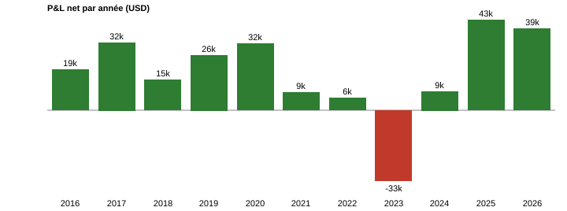
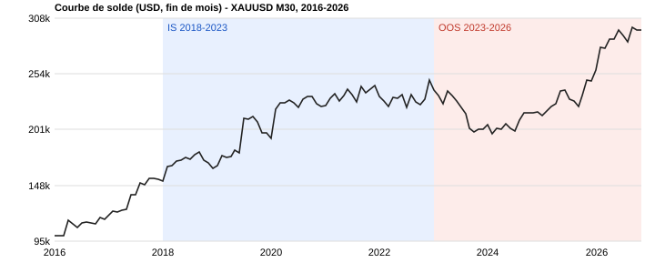

# Donchian TrendFollow — XAUUSD M30

Stratégie de suivi de tendance par cassure de canal Donchian (inspirée des Turtles), codée en MQL5.

> **EN summary** — Donchian-channel breakout trend follower on XAUUSD M30, tested 2016-2026 (2,569 positions). MT5 profit factor 1.19, Sharpe 0.92, max drawdown 22-24%. IS (2018-2022) and OOS (2023-2026) are consistent (PF 1.22 vs 1.21 per position). **Key limitations: net profit is concentrated in ~10 positions (typical fat-tail trend following), swap costs total -56k USD, and the result depends on the 1R partial exit: without it, max drawdown rises to 48% and Sharpe falls to 0.42. Backtested on synthetic ticks; a real-tick re-test is pending.**

## Idée

Les marchés tendanciels produisent quelques mouvements très larges. La stratégie accepte de nombreuses petites pertes (45 % de positions gagnantes, 11 % sans sortie partielle) pour capturer ces mouvements : gain moyen 806 USD contre perte moyenne 521 USD par position.

## Logique (version testée)

- **Entrée** : clôture hors du canal Donchian de 10 barres (entrée rapide).
- **Sortie** : clôture hors du canal de 110 barres (sortie lente), plus SL ATR(14) × 1,0 comme filet.
- **Filtre actif** : compression du canal (largeur du canal de 20 barres sous le 50e percentile de ses 200 dernières valeurs).
- **Sizing** : risque fixe de 500 USD par trade (0,5 % du capital initial), modulé par un vol-target (facteur borné entre 0,4 et 1,25).
- **Gestion** : sortie partielle de 50 % à 1R, time stop (40 barres, fermeture si progression < 0,5R), règles de ré-entrée après perte, limites de risque journalières.
- **Options disponibles mais désactivées** : ensemble de 3 canaux, t-stat de pente, Efficiency Ratio, régime de volatilité, session, spread, news, EMA HTF, breakeven, trailing.

Inputs exacts : [`Donchian_TF_M30_tested.set`](Donchian_TF_M30_tested.set). Code : [`Donchian_TrendFollow_EA.mq5`](Donchian_TrendFollow_EA.mq5).

> Note : la valeur par défaut du timeframe dans le code est M15 ; le test a été fait en **M30** (voir le `.set`).

## Protocole de test

- Optimisation en **IS 2018-2023**, validation en **OOS 2023 - fin sept. 2026**, puis test sur **2016 - oct. 2026**.
- Données : IC Markets (EU) Demo, XAUUSD, qualité d'historique 87 %. Les exécutions du rapport n'apparaissent qu'aux secondes 0, 20, 40 et 59 : les ticks sont synthétiques (générés depuis des barres M1), pas des ticks réels. Dépôt initial 100 000 USD, levier 1:100.

## Résultats (2016-01-19 → 2026-10-23)

| Métrique | Valeur |
|---|---|
| Positions (entrées) | 2 569 (longs 1 335, shorts 1 234) |
| Transactions de clôture (partiels inclus) | 3 844 |
| Profit net | +196 646 USD |
| Profit factor | 1,19 (MT5, par transaction) ; 1,27 par position |
| Sharpe | 0,92 |
| Espérance par position | +76,5 USD |
| Positions gagnantes | 45,0 % |
| Gain moyen / perte moyenne (par position) | 806 USD / −521 USD |
| Drawdown max (solde) | 56 464 USD (22,43 %) |
| Drawdown max (equity) | 61 997 USD (24,10 %) |
| Facteur de récupération | 3,17 |
| Pertes consécutives max | 11 positions |
| Durée moyenne de position | 18 h 08 |

Les statistiques de MetaTrader comptent chaque sortie partielle comme une transaction : les chiffres « par position » ci-dessus sont recalculés à partir des transactions du rapport.

### IS / OOS

Découpage par date de clôture des positions.

| Période | Positions | Profit net | Profit factor (par position) |
|---|---|---|---|
| 2016-2017 (hors optimisation) | 256 | +51 288 USD | 1,72 |
| IS 2018-2022 | 1 337 | +87 669 USD | 1,22 |
| OOS 2023 - sept. 2026 | 976 | +57 689 USD | 1,21 |

### Par année

## Sensibilité : sans sortie partielle

Même stratégie avec `InpUsePartialExit=false` (période 2016 - oct. 2026, mêmes données) :

| | Avec sortie partielle (version testée) | Sans sortie partielle |
|---|---|---|
| Profit net | +196 646 USD | +158 810 USD |
| Profit avant swap | 253 122 USD | 246 983 USD |
| Swap | −56 476 USD | −88 173 USD |
| Profit factor (par position) | 1,27 | 1,12 |
| Sharpe | 0,92 | 0,42 |
| Drawdown max (solde / equity) | 22,4 % / 24,1 % | 48,1 % / 52,2 % |
| Positions | 2 569 | 2 714 |
| Positions gagnantes | 45,0 % | 11,2 % |
| Gain moyen / perte moyenne | 806 / −521 USD | 5 002 / −565 USD |
| Pertes consécutives max | 11 | 48 (−27 467 USD) |
| 5 plus gros trades / profit net | 63 % | 127 % |
| PF IS 2018-2022 / OOS 2023-2026 | 1,22 / 1,21 | 1,10 / 1,09 |
| Année 2023 | −33 342 USD | −75 963 USD |

Retirer la sortie partielle change peu le profit avant swap (247 000 contre 253 000 USD), mais double le drawdown et divise le Sharpe par deux. La sortie partielle agit surtout comme un réducteur de risque. Une partie de son bénéfice apparent vient aussi du dépassement à la sortie avec des ticks synthétiques (voir la limite 7) : le résultat avec des ticks réels se situe vraisemblablement entre les deux colonnes.

## Coûts

- **Swap : −56 476 USD** sur la période, soit environ 22 % du profit avant swap (253 122 USD).
- **Commission : 0 USD** dans ce test (type de compte sans commission). Un compte à commission réduirait le résultat ; à tester.
- Spread : celui du broker dans le testeur MT5.

## Limites (à lire avant toute conclusion)

1. **Concentration des gains.** Les 10 plus grosses positions représentent 100,6 % du profit net. Sans elles : −1 255 USD. Sans les 20 plus grosses : −115 697 USD. La plus grosse seule pèse 16,5 % du total (janv. 2020). C'est le profil attendu d'un trend following à queues épaisses, mais l'edge repose sur la fréquence de ces événements. Sans sortie partielle, c'est encore plus net : les 5 plus gros trades font 127 % du profit.
2. **Année 2023 : −33 342 USD**, première année de la période OOS.
3. **Dépendance à l'or.** 2025 et 2026 (+42 966 USD et +38 786 USD) coïncident avec une forte tendance haussière ; un régime sans tendance dégraderait les résultats.
4. **Un seul actif, un seul backtest.** Pas encore de test sur d'autres instruments ni de walk-forward complet.
5. **Optimisation sur les paramètres** : la proximité IS/OOS est encourageante, mais ne remplace pas une étude de sensibilité.
6. **Swap significatif** : la rentabilité dépend des conditions de financement du broker.
7. **Dépassement des sorties partielles.** Les sorties partielles à +1R sont fermées au marché au premier tick au-delà du niveau. Avec des ticks synthétiques, elles sortent en moyenne à +1,20R (médiane +1,11R) au lieu de +1,00R : ce dépassement représente environ 72 700 USD, soit 37 % du profit net. Le test sans sortie partielle (section ci-dessus) donne +158 810 USD mais avec un drawdown de 48 %. Voir le [post-mortem AMRM](../../../research/amrm-postmortem/README.md) pour le même effet sur une autre stratégie.

## Prochaines étapes

- Test « sans les N meilleurs trades » et bootstrap de la séquence de trades.
- Heatmap de sensibilité des paramètres clés (périodes d'entrée/sortie).
- Walk-forward glissant.
- Test avec commissions réalistes.
- Relancer en ticks réels, avec et sans sortie partielle (en attente d'un ordinateur assez puissant).
- Application à d'autres instruments.
