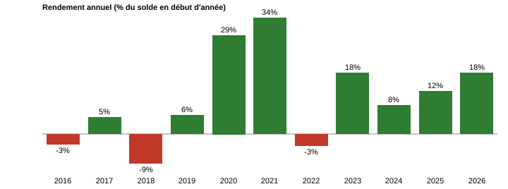

# SuperTrend + entrée sur pullback — XAUUSD M30

Stratégie de suivi de tendance basée sur la SuperTrend (ATR), avec filtre de tendance DEMA, entrée sur rebond après le flip et pyramidage sur repli. Codée en MQL5.

> **EN summary** — SuperTrend trend follower on XAUUSD M30 with DEMA(250) trend filter, pullback entry after the flip and pyramiding on pullbacks. Tested 2016-2026: 1,795 signals (2,793 positions incl. adds), profit factor 1.24, Sharpe 1.24, max balance drawdown 21%. IS (2016-2021) and OOS (2022-2026) are consistent (PF 1.30 vs 1.28, CAGR 9.4% vs 10.8%). **Main caveats: returns are concentrated in 2020-2021 and 2023-2026 (flat 2016-2019), 10 signals make 72% of the profit, and pyramiding raises net profit by 40% but max drawdown by 80%: it behaves like leverage.**

## Idée

La SuperTrend suit une ligne dynamique basée sur l'ATR ; un « flip » signale un changement de tendance. Comme tout suiveur de tendance, la stratégie perd souvent (~32 % de signaux gagnants) mais capture quelques grands mouvements : gain moyen 889 USD contre perte moyenne 427 USD par position.

## Logique (version testée, v3.40)

- **Signal** : SuperTrend (ATR 25, multiplicateur 3,0, source = clôture) sur **M30**. Un flip ferme la position opposée (stop-and-reverse).
- **Filtre de tendance** : DEMA 250 (longs au-dessus, shorts en dessous).
- **Entrée sur pullback** : après un flip, on n'entre pas tout de suite. On attend un rebond de 0,5 × ATR depuis l'extrême du flip, puis une bougie M5 de reprise dans le sens du flip. Annulé si le prix clôture au-delà de la ligne SuperTrend, ou après 12 barres M30.
- **Stop** : la ligne SuperTrend elle-même, remontée en cliquet (jamais en arrière). Pas de take profit.
- **Sizing** : 0,5 % du solde par trade, calculé sur la distance au stop. Le risque étant en % du solde, **les gains en dollars croissent mécaniquement avec le capital** (voir rendements en %).
- **Pyramidage sur repli** : jusqu'à 3 ajouts à 0,25 % de risque, seulement si le trade a déjà gagné 2R, qu'un repli de 0,5 × ATR s'est produit, puis une bougie de reprise, et que le stop est au moins au point d'entrée.
- **Options disponibles mais désactivées** : filtre ER/ADX, entrée M5 simple, régression linéaire, ré-entrée, pause en range, réduction du risque en drawdown.

Inputs exacts : [`SuperTrend_M30_tested.set`](SuperTrend_M30_tested.set). Code : [`SuperTrend_ER_EA_v3.mq5`](SuperTrend_ER_EA_v3.mq5).

> Note : certains inputs par défaut du code (ER, ADX, longueur de régression) diffèrent du `.set` testé ; ils sont sans effet car ces filtres sont désactivés.

## Protocole de test

- Optimisation en **IS 2016-2021** (fin 2021 incluse), validation en **OOS 2022-aujourd'hui**, puis test sur toute la période (2016-02-08 → 2026-10-23).
- Données : IC Markets (EU) Demo, XAUUSD, qualité d'historique 87 %. Les exécutions du rapport n'apparaissent qu'aux secondes 0, 20, 40 et 59 : les ticks sont synthétiques (générés depuis des barres M1), pas des ticks réels. Dépôt initial 100 000 USD, levier 1:100.
- Compte de type hedging : chaque ajout est une position séparée. Le « nombre de trades » MT5 (2 793) compte les positions ; on dénombre **1 795 signaux** (entrées initiales) dont 998 ajouts de pyramide.

## Résultats

| Métrique | Valeur |
|---|---|
| Solde final | 277 101 USD (profit net +177 101 USD) |
| Signaux / positions | 1 795 / 2 793 |
| Profit factor (positions) | 1,24 (signaux : 1,29) |
| Sharpe | 1,24 |
| Facteur de récupération | 4,26 |
| Positions gagnantes | 37,27 % (signaux : 32,4 %) |
| Gain moyen / perte moyenne (positions) | 889 USD / −427 USD |
| Drawdown max (solde) | 37 864 USD (21,06 %) |
| Drawdown max (equity) | 41 593 USD (22,71 %) |
| Pertes consécutives | jusqu'à 16 ; pire série en USD : −11 257 USD (12 trades) |
| Durée moyenne de position | 15 h 21 |

### IS / OOS

Découpage au 1er janvier 2022, par date de clôture des signaux.

| Période | Signaux | Profit net | Profit factor | Rendement annualisé | Drawdown max (solde) |
|---|---|---|---|---|---|
| IS 2016-2021 | 935 | +69 487 USD | 1,30 | 9,4 % | 16,9 % |
| OOS 2022-2026 | 860 | +107 614 USD | 1,28 | 10,8 % | 18,7 % |

Le profit factor et le rendement annualisé sont proches entre IS et OOS, ce qui est encourageant.

### Rendement annuel

## Pyramidage : un levier, pas un edge

Comparaison des positions initiales seules et du total (drawdown calculé sur les trades clôturés) :

| | Profit net | Drawdown max | Profit net / drawdown |
|---|---|---|---|
| Positions initiales seules (1 795) | +126 507 USD | 21 037 USD (14,1 %) | 6,0 |
| Avec pyramidage (2 793 positions) | +177 101 USD | 37 864 USD (21,1 %) | 4,7 |

Les ajouts sont individuellement rentables (998 positions, +50 594 USD, PF 1,33), mais ils augmentent le profit de 40 % et le drawdown de 80 %. Le ratio profit/drawdown se dégrade : le pyramidage agit comme une hausse du risque par trade, pas comme une amélioration de l'edge. La référence pour juger la stratégie est donc la version sans pyramidage.

## Coûts

- **Swap : −14 111 USD**, soit environ 7 % du profit avant swap (191 212 USD).
- **Commission : 0 USD** dans ce test (type de compte sans commission) ; à tester avec des coûts réalistes.
- Spread : celui du broker dans le testeur MT5.

## Limites (à lire avant toute conclusion)

1. **Rendements irréguliers dans le temps.** Les années 2016 à 2019 sont plates (solde de 98 219 USD fin 2019 pour 100 000 USD au départ, avec 2016 et 2018 négatives). Les gains viennent de 2020-2021 (+28,9 % et +33,9 %) et de 2023-2026. La proximité IS/OOS ne dit pas comment la stratégie se comporte dans un marché de l'or sans tendance.
2. **Concentration des gains.** Les 10 plus gros signaux représentent 72 % du profit net. Sans eux : +48 873 USD. Sans les 20 plus gros : −42 024 USD.
3. **Pyramidage = levier** (voir plus haut) : les résultats avec pyramidage ne sont pas comparables à ceux d'une stratégie à risque constant.
4. **Capitalisation.** Le risque est en % du solde : comparer les années en %, pas en dollars.
5. **Un seul actif retenu.** Les tests sur d'autres marchés n'ont été concluants que sur l'or et, en long seulement, sur le Nasdaq ; US500 et DXY sont perdants.
6. **Optimisation** : ATR, multiplicateur, DEMA et pullback ont été ajustés ; pas encore de carte de sensibilité ni de walk-forward.
7. **Ticks synthétiques.** Les sorties passent surtout par le stop en attente placé sur la ligne SuperTrend (suivie en cliquet), donc elles sont peu exposées au dépassement observé sur d'autres stratégies. L'effet de la modélisation des ticks sur l'entrée par pullback (bougies M5) et sur la pyramide n'a toutefois pas été mesuré. Voir le [post-mortem AMRM](../../../research/amrm-postmortem/README.md) pour un exemple où ce type d'effet fabriquait l'avantage.

## Prochaines étapes

- Relancer le test **sans pyramidage** (`InpUsePyramid=false`) et publier ce rapport comme référence.
- Carte de sensibilité (période ATR, multiplicateur, période DEMA).
- Walk-forward glissant.
- Test avec commissions réalistes.
- Relancer en ticks réels pour confirmer les résultats (en attente d'un ordinateur assez puissant).
- Test « sans les N meilleurs trades » et bootstrap de la séquence de trades.
